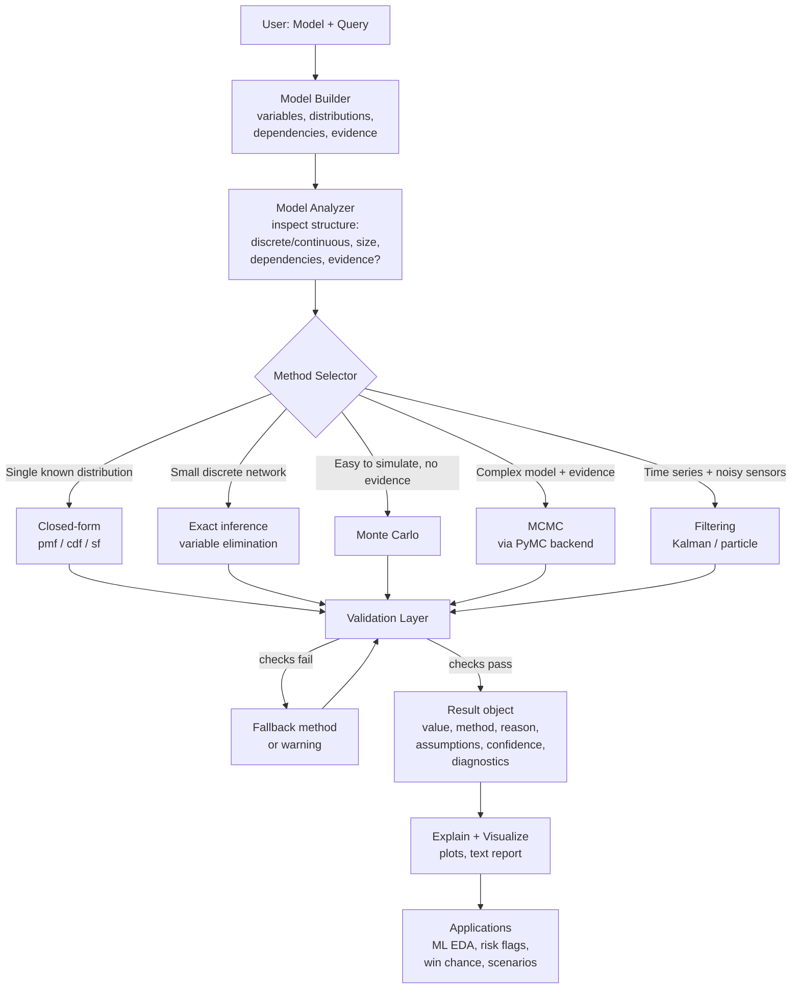
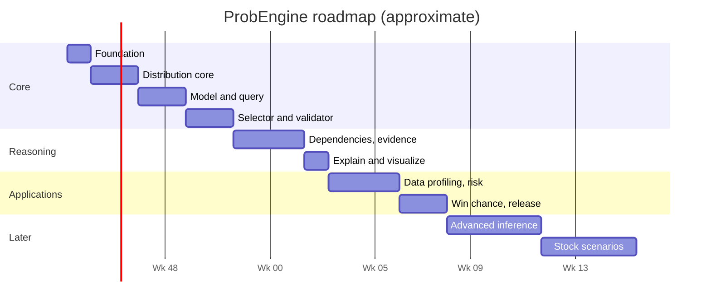

# ProbEngine: A Probability Engine Library

*A reusable "physics engine for uncertainty": describe the problem, the engine picks the method and solves it.*

---

## 1. Problem Statement

Probability tools today are fragmented:

- **Calculators** (online tools, textbooks) solve one formula at a time. The user must already know which distribution applies.
- **Libraries** (SciPy, PyMC, Stan, Pyro) are powerful but each covers one slice: distributions, Bayesian sampling, or probabilistic programming. The user must choose the method and understand its assumptions.
- **ML workflows** need distribution analysis, anomaly flagging and risk scoring, but every project re-implements the same probability code by hand.
- **Silent errors:** the common failure is not a wrong formula, it is the right formula applied to the wrong model (e.g. Poisson when events cluster, Binomial when trials are dependent), and nothing warns the user.

**The gap:** there is no reusable, general-purpose layer that takes a description of an uncertain system and *decides how to compute the answer*, the way a physics engine takes objects and forces and decides how to simulate them.

### Goals

| # | Goal |
|---|------|
| G1 | A developer describes a problem (variables, distributions, dependencies, evidence) and asks a question. |
| G2 | The engine automatically selects a suitable computation method. |
| G3 | Every answer reports **which method was used, why, and what was assumed**. |
| G4 | Answers are cross-checked (e.g. exact vs. simulation) before being returned. |
| G5 | The same core serves data analysis, risk flagging, simple predictions and (later) financial scenarios. |

### Non-goals (stated honestly)

- Not a system that "predicts everything". A common engine is realistic; a universal oracle is not.
- Not an LLM wrapper. Calculations are done by deterministic numerical code.
- Not a replacement for SciPy/PyMC. It is the decision layer on top of them.

---

## 2. Proposed Solution

### 2.1 Core idea

Separate three things that other tools mix together:

1. **Model**: *what* is uncertain (variables, distributions, dependencies, evidence).
2. **Query**: *what* you want to know (a probability, a distribution, a risk flag).
3. **Solver**: *how* to compute it (exact formula, simulation, MCMC, ...).

The user writes 1 and 2. The engine owns 3.

### 2.2 Architecture flow chart



### 2.3 Plain-text version of the same flow

```
 User: Model + Query
        |
        v
 Model Builder  ->  Model Analyzer (what kind of problem is this?)
        |
        v
 Method Selector
   |- closed form  |- exact inference  |- Monte Carlo  |- MCMC  |- filtering
        |
        v
 Validation Layer (range checks, complement check, exact-vs-simulation)
        |
        v
 Result: value + method + reason + assumptions + diagnostics
        |
        v
 Explain + Visualize  ->  Applications
```

### 2.4 Layers in detail

| Layer | Responsibility | Built on |
|-------|---------------|----------|
| **Distributions** | Bernoulli, Binomial, Geometric, Negative Binomial, Poisson, Hypergeometric, Uniform, Normal, Exponential. Provide pmf/pdf, cdf, sf, mean, variance, sampling. | SciPy |
| **Model** | Holds variables, dependencies, evidence. Supports `m.var()`, `m.depends()`, `m.observe()`. | Pure Python |
| **Analyzer** | Classifies the model: single vs. joint, discrete vs. continuous, size, dependency structure, evidence present, temporal or not. | Pure Python |
| **Method Selector** | Rule-based decision table (see 2.5). Returns the chosen method *and the reason*. | Pure Python |
| **Solvers** | Closed-form, exact inference, Monte Carlo, MCMC, filtering. | SciPy, NumPy, PyMC |
| **Validator** | Independent sanity and accuracy checks (see 2.6). | NumPy |
| **Reporter** | Result object, text explanation, plots. | Matplotlib / Plotly |

### 2.5 Method selection rules (v1, rule-based and transparent)

| Condition detected | Method chosen | Why |
|---|---|---|
| One variable with a supported distribution, no dependencies | Closed-form | Exact and instant |
| Several discrete variables, small joint space, dependencies | Exact inference (variable elimination) | Exact is feasible, so don't approximate |
| Event is easy to simulate, no evidence, no closed form | Monte Carlo | Simple, with a known error bound |
| Complex model **with** evidence (posterior needed) | MCMC | Direct sampling not possible |
| State changes over time with noisy observations | Kalman / particle filter | Designed for sequential updating |
| Rare event (very small probability) | Warn, then importance sampling (later stage) | Plain Monte Carlo needs enormous samples |

Rules are explicit and testable. A machine-learned selector is only considered later, once a benchmark exists to prove it is better.

### 2.6 Validation layer: what makes the engine trustworthy

1. **Range check:** every probability is in [0, 1].
2. **Complement check:** P(A) + P(not A) = 1.
3. **Distribution check:** probabilities of all outcomes sum to 1 (discrete).
4. **Cross-method check:** exact result vs. Monte Carlo estimate must agree within the expected sampling error.
5. **Assumption check:** flags violated or unverifiable assumptions (e.g. "independence assumed, not tested").
6. **Convergence diagnostics** for MCMC (e.g. R-hat, effective sample size).

If a check fails, the engine tries a fallback method or returns the result **with a warning**, never silently.

### 2.7 The Result object (the key design decision)

```python
result = m.query(defect == 4)

result.value        # 0.1706
result.method       # "exact: binomial pmf"
result.reason       # "single supported distribution, no dependencies"
result.assumptions  # ["fixed n=100", "independent trials", "constant p=0.03"]
result.checks       # {"range": "pass", "monte_carlo_agreement": "pass"}
result.confidence   # "exact"   (or "approx ± 0.002" for sampled results)
result.plot()       # distribution graph with the queried event highlighted
```

Every answer is auditable. This is the main difference from a plain calculator.

### 2.8 Public API sketch

```python
from probengine import Model, Binomial, Normal, Poisson

# 1. Simple query
m = Model()
defect = m.var("defects", Binomial(n=100, p=0.03))
print(m.query(defect == 4).value)

# 2. Query a range
print(m.query(defect >= 3).value)

# 3. Dependencies + evidence
m = Model()
rain    = m.var("rain",    Bernoulli(p=0.3))
traffic = m.var("traffic", Bernoulli(p=0.2), depends_on=rain, cpt={...})
m.observe(rain == 1)
print(m.query(traffic == 1).value)    # engine picks exact inference

# 4. Fit from data
m = Model.from_data(df["marks"])      # suggests a distribution, shows fit quality
```

---

## 3. Application Examples

### Application 1: Understanding data during ML work

**Need:** before training, understand each feature's distribution, spot skew, outliers and bad fits.

```python
import probengine as pe

report = pe.profile(df)            # runs on every numeric column
report["marks"].best_fit           # e.g. Normal(mu=62, sigma=14)
report["marks"].fit_quality        # goodness-of-fit result
report["marks"].plot()             # histogram + fitted curve
report.summary()                   # skewness, outliers, suggested transforms
```

**What the engine does:** fits candidate distributions, compares them, draws graphs, and reports assumption warnings (e.g. "column is heavily right-skewed; Normal is a poor fit").

**Output:** distribution plots, best-fit model per column, outlier list.

---

### Application 2: Student failure risk flagging (anomaly / risk)

**Need:** from historical marks and attendance, add a new column that flags students likely to fail.

```python
import probengine as pe

risk = pe.RiskModel(target="failed")
risk.fit(history_df, features=["attendance", "internal_marks", "assignments"])

new_df["fail_probability"] = risk.predict_proba(new_df)
new_df["risk_flag"] = pe.flag(new_df["fail_probability"], threshold=0.35)
new_df["why"] = risk.explain(new_df)    # main contributing factors
```

**What the engine does:** estimates a failure probability per student, **checks that the probabilities are calibrated** (a predicted 30% should fail about 30% of the time), then flags by threshold.

**Output:** new columns `fail_probability`, `risk_flag`, `why`, plus a calibration plot.

**Notes:** this is a data-driven prediction. It needs enough historical data and is evaluated on held-out data. A flag means "needs attention", not "will fail".

---

### Application 3: Everyday chance questions (winning, outcomes)

**Need:** quick answers such as "chance my team wins the series" or "chance of at least 3 successes".

```python
m = pe.Model()
wins = m.var("wins", Binomial(n=7, p=0.58))   # best-of-7, p per game
print(m.query(wins >= 4).value)               # chance of winning the series
```

With evidence ("we are already 2-1 up"), the engine conditions on it and updates the answer. The result states its assumptions (games independent, constant win chance).

**Output:** probability, explanation, a simple bar chart of outcomes.

---

### Application 4: Stock price scenarios (later stage)

**Need:** estimate the range and probabilities of future price outcomes.

```python
m = pe.TimeSeriesModel.from_prices(prices, model="gbm")   # or other model
scenarios = m.simulate(days=30, n_paths=100_000)
scenarios.probability(lambda path: path[-1] > current * 1.05)
scenarios.fan_chart()
```

**What the engine does:** fits a stochastic price model, simulates many future paths, reports probabilities and intervals, and evaluates them against outcomes it did not train on.

**Important honesty:** this produces **scenario probabilities under a stated model**, not a reliable prediction of the market. Markets change behaviour, and simple models (such as geometric Brownian motion) often underestimate extreme moves. The engine must display this limitation in the output. This is why it is a *late* stage.

---

## 4. Development Stages and Midpoints

Each stage ends with a **checkpoint** that must pass before moving on.

### Stage 0: Foundation (Week 1)
- Project setup, package layout, testing and linting.
- Define the `Result` object and public API sketch.
- **Checkpoint:** API examples in this document run as stubs; a test suite exists.

### Stage 1: Distribution core (Weeks 2-3)
- Wrap SciPy distributions: Bernoulli, Binomial, Geometric, Negative Binomial, Poisson, Hypergeometric, Uniform, Normal, Exponential.
- Support pmf/pdf, cdf, sf, mean, variance, sampling.
- **Checkpoint:** all values match known textbook answers; 100% of distribution tests pass.

### Stage 2: Model and query layer (Weeks 3-5)
- `Model`, `var`, comparison queries (`==`, `>=`, `<`, ranges).
- Closed-form solver and Monte Carlo solver.
- **Checkpoint:** the `defect == 4` example returns 0.1706 with correct method and assumptions.

### Stage 3: Method selector + validator (Weeks 5-7)
- Analyzer and rule-based selector (table in 2.5).
- Validator with range, complement and exact-vs-simulation checks.
- **Checkpoint (midpoint review):** a benchmark of 50 hand-checked problems; the selector chooses an acceptable method on at least 90% and validator catches deliberately broken inputs.

### Stage 4: Dependencies and evidence (Weeks 7-10)
- Conditional probabilities, small discrete Bayesian networks, exact inference.
- Bayesian updating (e.g. Beta-Binomial) and `observe()`.
- **Checkpoint:** known Bayes problems (medical test, coin bias) solved correctly and match PyMC results.

### Stage 5: Explain and visualize (Weeks 10-11)
- Text explanations, distribution plots, outcome highlight plots.
- **Checkpoint:** every result can print a readable report and a graph.

### Stage 6: Application 1 and 2 (Weeks 11-14)
- `profile(df)` for data understanding.
- `RiskModel` with calibration checks and the flagging helper.
- **Checkpoint (second midpoint):** the student-risk example runs end-to-end on a real or synthetic dataset, evaluated on a held-out split, with a calibration plot.

### Stage 7: Application 3 + packaging (Weeks 14-16)
- Win-chance and everyday-query helpers, documentation, example notebooks.
- Publish a first release (v0.1).
- **Checkpoint:** a new user can install and run all three applications from the docs alone.

### Stage 8: Advanced inference (later)
- MCMC backend via PyMC, filtering (Kalman / particle), rare-event handling.
- **Checkpoint:** convergence diagnostics are reported and a known hard case passes.

### Stage 9: Stock scenarios (later)
- Time-series models, path simulation, backtesting against unseen data.
- **Checkpoint:** results are out-of-sample tested and always shipped with limitation warnings.

### Stage overview



---

## 5. Testing and Evaluation Strategy

| What | How |
|---|---|
| Numerical correctness | Unit tests against textbook answers and SciPy reference values |
| Method selection | Benchmark of 50 to 100 hand-labelled problems with an acceptable-method list |
| Ambiguity and bad input | Tests with missing parameters, impossible values, contradictory evidence |
| Cross-checking | Exact vs. Monte Carlo agreement within a statistical tolerance |
| Predictive applications | Held-out data, calibration curves, Brier score |
| Robustness | Small changes in inputs must not flip the chosen method unexpectedly |
| Regression | Continuous integration runs everything on every change |

---

## 6. End Result

A Python library, `probengine`, where a developer can:

1. Describe an uncertain system in a few lines.
2. Ask a probability question.
3. Get back the answer, the method used, the reason, the assumptions and the validation status.
4. Plot distributions and outcomes.
5. Reuse the same core for data analysis, risk flagging, everyday predictions and, later, financial scenarios.

---

## 7. Advantages

| Advantage | Explanation |
|---|---|
| **No method knowledge required** | The engine chooses closed form, exact inference, Monte Carlo or MCMC. |
| **Transparent, not a black box** | Every result shows method, reason and assumptions. |
| **Self-checking** | Cross-method validation catches wrong answers before the user sees them. |
| **Reusable** | One core serves ML profiling, risk flagging, simple predictions and scenarios. |
| **Builds on trusted tools** | SciPy, NumPy and PyMC do the math; the engine does not reinvent them. |
| **Honest about limits** | Warns about invalid assumptions, rare events and weak data. |
| **Extensible** | New distributions and solvers plug in without changing the user API. |
| **Educational** | The explanations teach why a model was chosen. |

---

## 8. Risks and Limitations

| Risk | Mitigation |
|---|---|
| Wrong model chosen for a real problem | Rule-based selector, explicit assumptions, user can override the method |
| Scope creep ("universal engine") | Fixed stage plan; each stage has a checkpoint and a limited supported-problem list |
| Poor predictions from poor data | Held-out evaluation, calibration checks, data-quality warnings |
| Stock results misread as forecasts | Always labelled as scenarios under a model; out-of-sample testing |
| Rare events mis-estimated by simulation | Detection warning; importance sampling in a later stage |
| Overlap with existing libraries | Value is the selection, validation and explanation layer, which should be demonstrated by the benchmark |

---

## 9. Future Extensions

- Learned (data-driven) method selector, only if it beats the rules on the benchmark.
- Natural-language front end that produces the structured `Model` (LLM interprets, engine computes).
- Causal modelling support.
- Quantum probability backend with its own mathematical rules.
- Reliability and survival analysis module.
- Web UI with FastAPI backend and React frontend.

---

## 10. Success Criteria

- The `defect == 4` example works exactly as specified, returning 0.1706.
- At least 90% acceptable method choice on the 50-problem benchmark.
- Student-risk probabilities are calibrated on held-out data.
- Every query returns method, reason, assumptions and validation status.
- A new user can complete all applications from the documentation.
